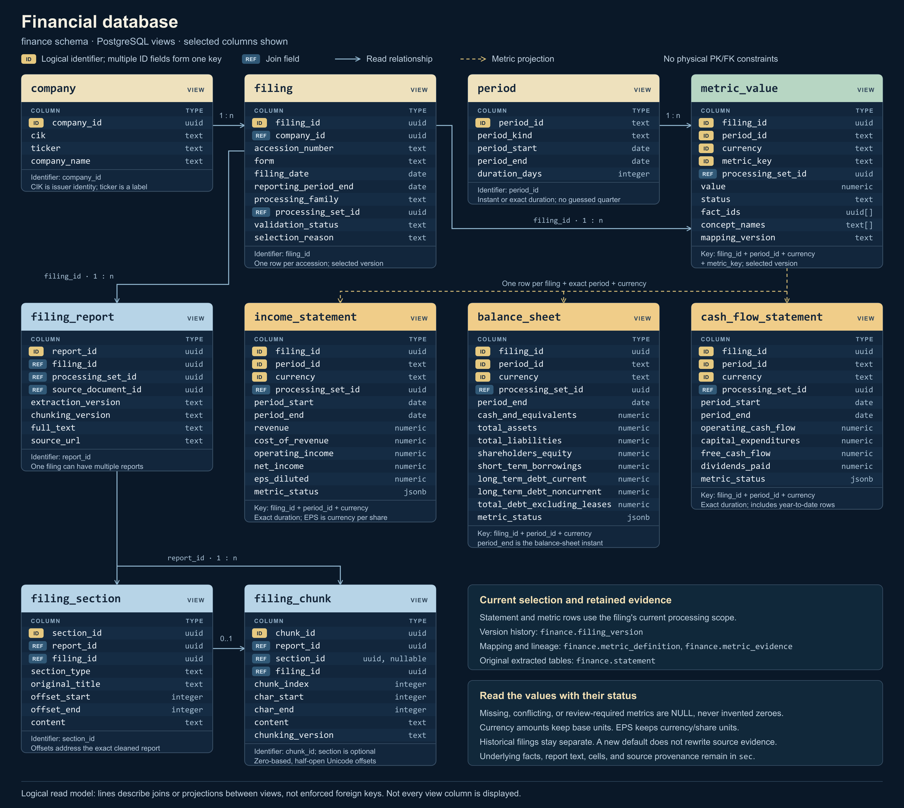

# Financial browsing schema

The `finance` schema provides familiar company, filing, income statement, balance sheet, and cash flow views. It reads the existing `sec` records and retains their source identities. It does not replace source tables, rewrite facts, or change stored processing-set preferences.

**Deployment:** migration `010_finance_browsing.sql` was applied to the shared RDS database and freshly verified on **October 22, 2026**. All 14 finance views are available. The 25 original data tables and 19 existing source views were preserved; effective read-only access was checked for `sec_reader` and its 11 member roles. Other database instances require their own migration. See the [deployment record](aws-deployment.md#financial-browsing-schema-october-22-2026).

[](database-finance.svg)

[Open the scalable SVG diagram](database-finance.svg).

The diagram is a logical reading map. The objects below are SQL views; a database client's automatic foreign-key diagram may not draw these relationships. In DBeaver, refresh the connection, expand **Schemas → finance → Views**, then open the required view's data.

## Start with these views

| View | What one row represents |
| --- | --- |
| `finance.company` | One issuer, identified by `company_id` and CIK; name and ticker are display fields. |
| `finance.filing` | One SEC filing, with its accession and the processing version currently selected for browsing. |
| `finance.filing_version` | One recorded processing set, including its family, validation status, coverage, and whether it has an explicit legacy preference. |
| `finance.income_statement` | One filing's selected version, exact duration, and currency, with revenue, costs, operating income, net income, and diluted EPS columns. |
| `finance.balance_sheet` | One filing's selected version, exact instant, and currency, with cash, assets, liabilities, equity, and debt components. |
| `finance.cash_flow_statement` | One filing's selected version, exact duration, and currency, with operating cash flow, cash PP&E purchases, derived free cash flow, and dividends. |
| `finance.period` | One exact observed instant or duration for supported metrics. Dates are not converted into inferred fiscal quarters. |
| `finance.metric_definition` | One supported metric's concept mappings, units, period kind, method, and definition. |
| `finance.metric_value` | One resolved or derived metric, with status, exact period, currency, source `fact_ids`, and `concept_names`. |
| `finance.metric_evidence` | One candidate source fact mapped to a metric, including eligibility, exclusion reason, original value, unit, dimensions, and citation. |
| `finance.statement` | One original source table in the selected version, with readable text, source identifiers, validation status, and coverage. |
| `finance.filing_report` | One selected cleaned report version. |
| `finance.filing_section` | One named section sliced from its exact report version. |
| `finance.filing_chunk` | One original retrieval chunk, including its source identity and exact report offsets. |

The three standardized statement views are selected metrics, not complete reproductions of every statement row. Use `finance.statement` for the original extracted statement text and `sec.table_cells` for its physical cells. The full parser layout remains in `sec.financial_tables.structure`.

## Understand the selected version

`finance.filing` chooses a browsing version without writing a preference:

1. Use an explicitly preferred legacy processing set, when one exists.
2. Otherwise, use a source-family processing set, preferring a fact-bearing set and then the newest recorded set. A version requiring review remains visible.
3. Otherwise, use a passed legacy set, preferring one with facts and then the newest recorded set.

`selection_reason`, `processing_family`, `processing_set_id`, `validation_status`, and `coverage` make this choice inspectable. Tied timestamps are resolved deterministically by processing-set ID. A filing without an eligible processing set remains in `finance.filing` with `selection_reason = 'no_processed_content'`.

When the selected set has not passed validation, all numeric metrics for that set are withheld as `review_required`. The original evidence remains inspectable. This prevents a newer version requiring review from silently becoming an older set's apparently approved numbers.

Processing versions and financial restatements are different. A processing set describes an extraction of one filing. The same reporting period can appear in an original filing, an amendment, and a later comparative statement. This layer preserves those filings separately; it does not automatically choose the latest restated value for a company and period.

For reproducibility, record the accession, processing family, processing-set ID, mapping version, exact dates, and currency. Filtering a convenience view by a saved set ID protects against silently reading a new default: if selection changes, the query returns no row. It does **not** make that convenience view replay an older default. Use the saved set with canonical `sec` records when historical replay is required.

## Read values and status together

Every standardized statement row contains `metric_status`, a JSON object with one status per metric. The same status appears as `finance.metric_value.status`.

| Status | Meaning |
| --- | --- |
| `reported` | Eligible source occurrences agree on one exact numeric value. |
| `derived` | Every required reported input is present and the documented formula was applied. |
| `missing` | No usable reported value or complete set of formula inputs is available. |
| `conflict` | Eligible occurrences disagree, or a required formula input conflicts. |
| `review_required` | The selected processing set has not passed validation. |

Missing, conflicting, and review-required values are SQL `NULL`. Missing is never converted to zero. An explicitly reported zero remains zero. Identical repeated occurrences are consolidated, not summed; their fact IDs remain available through `metric_value`.

Source statement, report, section, and chunk views also expose the selected version's validation and coverage. Their text remains inspectable even when numeric metrics are withheld.

`metric_evidence.exclusion_reason` provides more detail, including dimensioned facts, another or unknown issuer, an incompatible period or unit, unverified total-revenue evidence, nil/non-numeric facts, and unexpected negative cash outflows. A filing with no eligible or nil candidate periods can have no standardized statement rows at all; inspect `finance.filing` and `metric_evidence` rather than interpreting an empty result as a zero-valued statement.

## Metric definitions

Mappings apply to recognized US-GAAP namespaces and the filing issuer's facts with no explicit dimensions. An issuer-defined concept is not matched merely because its local name resembles a supported concept. Currency amounts retain their original XBRL base units and exact numeric precision; there is no conversion to USD, millions, or billions. Diluted EPS uses currency per share.

| Metric | Accepted concept or formula | Scope |
| --- | --- | --- |
| `revenue` | `Revenues`, `SalesRevenueNet`, or verified `RevenueFromContractWithCustomerExcludingAssessedTax` | Duration; the contract-revenue rule below applies. |
| `cost_of_revenue` | `CostOfRevenue` or `CostOfGoodsAndServicesSold` | Duration; the source concept is retained because coverage can differ. |
| `operating_income` | `OperatingIncomeLoss` | Duration. |
| `net_income` | `NetIncomeLoss` | Duration; attributable to the parent. |
| `eps_diluted` | `EarningsPerShareDiluted` | Duration; currency per share. |
| `cash_and_equivalents` | `CashAndCashEquivalentsAtCarryingValue` | Instant; restricted cash is not added. |
| `total_assets` | `Assets` | Instant. |
| `total_liabilities` | `Liabilities` | Instant; liabilities plus equity is not a substitute. |
| `shareholders_equity` | `StockholdersEquity` | Instant; attributable to the parent. |
| `short_term_borrowings` | `ShortTermBorrowings` | Instant; debt originally due within one year or the operating cycle. |
| `long_term_debt_current` | `LongTermDebtCurrent` | Instant; the current portion of long-term debt, excluding leases. |
| `long_term_debt_noncurrent` | `LongTermDebtNoncurrent` | Instant; the noncurrent portion of long-term debt, excluding leases. |
| `total_debt_excluding_leases` | Short-term borrowings + current long-term debt + noncurrent long-term debt | All three reported components must be present for the same instant and currency. |
| `operating_cash_flow` | `NetCashProvidedByUsedInOperatingActivities` | Duration; continuing-operations-only cash flow is not substituted. |
| `capital_expenditures` | `PaymentsToAcquirePropertyPlantAndEquipment` | Duration; cash PP&E purchases, expressed as a positive outflow. |
| `free_cash_flow` | Operating cash flow − cash PP&E purchases | The exact duration, currency, filing, and selected version must match. |
| `dividends_paid` | `PaymentsOfDividends` | Duration; total cash dividends/distributions, not common-only dividends. |

Contract revenue can exclude other revenue sources. It is eligible only when the exact fact is linked to an income-statement cell in the selected filing version whose normalized row heading is `Revenue`, `Revenues`, `Total Revenue`, `Total Revenues`, `Net Sales`, `Net Revenue`, `Net Revenues`, or `Sales`. Missing table evidence leaves that candidate unverified. Contract revenue including assessed tax is not substituted. The rule is deliberately narrow and does not claim to support every issuer's vocabulary.

When multiple accepted concepts or occurrences for the same metric have different values for one exact period and currency, the result is `conflict`; the layer does not choose the largest value or an arbitrary occurrence. The accepted mapping and contributing concepts remain visible through `metric_definition` and `metric_value`.

The definitions deliberately distinguish parent net income from `ProfitLoss`, parent equity from equity including noncontrolling interests, and total dividends from common-stock dividends. Debt components are separated by original maturity and current classification. `DebtCurrent`, which includes lease obligations, is not substituted for the three-component debt formula. These distinctions follow the [FASB 2025 taxonomy definitions](https://xbrl.fasb.org/us-gaap/2025/elts/us-gaap-doc-2025.xml) and [FASB 2026 taxonomy definitions](https://xbrl.fasb.org/us-gaap/2026/elts/us-gaap-doc-2026.xml).

Free cash flow is this layer's explicit calculation, not a reported GAAP subtotal or a claim that every company's preferred definition is identical. Cash PP&E purchases exclude noncash acquisitions and other possible uses of the term capital expenditure.

## Periods and comparisons

An income statement or cash flow row has `period_start`, `period_end`, and `duration_days`. A balance sheet row has its instant in `period_end`. `finance.period.period_kind` distinguishes these cases. `reporting_period_end` describes the filing's focus; it is not a replacement for a fact's own period.

A 10-Q can contain both three-month and nine-month results ending on the same date. Those remain separate rows. Cash flows are often cumulative year to date. Do not join durations solely on their end date, sum overlapping periods, infer an issuer's fiscal year from the calendar year, or derive a stand-alone quarter without an explicit policy. EPS must not be summed across quarters or calculated by subtracting year-to-date EPS.

## Example reads

Check that the schema exists, then inspect the selected filing versions:

```sql
SELECT to_regclass('finance.income_statement') AS income_statement_view;

SELECT accession_number, form, filing_date, reporting_period_end,
       processing_family, processing_set_id, set_key,
       selection_reason, validation_status, coverage
FROM finance.filing
WHERE ticker = 'MSFT'
ORDER BY filing_date DESC, accession_number DESC;
```

Read revenue with its actual duration and status. The filter excludes missing, conflicting, and review-required revenue:

```sql
SELECT accession_number, period_start, period_end, duration_days,
       currency, revenue, net_income, eps_diluted, metric_status,
       processing_family, processing_set_id
FROM finance.income_statement
WHERE ticker = 'MSFT'
  AND metric_status->>'revenue' = 'reported'
ORDER BY filing_date DESC, period_end DESC, period_start DESC;
```

Pin a current selection after copying its actual IDs from the first query. Empty results after a default changes require an explicit version review:

```sql
SELECT accession_number, period_start, period_end, currency,
       operating_cash_flow, capital_expenditures, free_cash_flow,
       dividends_paid, metric_status
FROM finance.cash_flow_statement
WHERE filing_id = 'REPLACE_WITH_FILING_UUID'::uuid
  AND processing_family = 'legacy'
  AND processing_set_id = 'REPLACE_WITH_PROCESSING_SET_UUID'::uuid
  AND metric_status->>'free_cash_flow' = 'derived'
ORDER BY period_end, period_start, currency;
```

Use `processing_family = 'source'` instead when that is the recorded family. Replace both placeholder UUIDs before running the query.

Trace a standardized number to every eligible original occurrence:

```sql
SELECT v.accession_number, v.metric_key, v.period_start, v.period_end,
       v.currency, v.value, v.status, v.mapping_version,
       e.fact_id, e.concept_namespace, e.concept_name,
       e.raw_value, e.source_reference, e.source_url, e.source_sha256
FROM finance.metric_value v
JOIN finance.metric_evidence e
  ON e.filing_id = v.filing_id
 AND e.processing_family = v.processing_family
 AND e.processing_set_id = v.processing_set_id
 AND e.fact_id = ANY(v.fact_ids)
WHERE v.ticker = 'MSFT'
  AND v.metric_key = 'revenue'
  AND v.status = 'reported'
ORDER BY v.accession_number, v.period_end, v.period_start, e.fact_id;
```

Inspect why a candidate was excluded, or read the original statement:

```sql
SELECT metric_key, concept_name, period_start, period_end, currency,
       raw_value, exclusion_reason, source_url
FROM finance.metric_evidence
WHERE ticker = 'MSFT' AND NOT eligible
ORDER BY filing_id, metric_key, period_end;

SELECT accession_number, s.statement_type, s.table_key,
       s.readable_text, s.source_url
FROM finance.statement s
JOIN finance.filing f USING (filing_id)
WHERE f.ticker = 'MSFT'
ORDER BY f.filing_date DESC, s.statement_type, s.table_key;
```

Section `offset_start`/`offset_end` and chunk `char_start`/`char_end` use zero-based, half-open Unicode character positions in the exact cleaned report. They are not byte positions, JavaScript UTF-16 positions, or offsets into the original HTML. See the [source browsing guide](database-browsing.md) for canonical reports, cells, facts, and processing sets.

## Extensions and verification

Sector and industry classifications, stock prices, embeddings, and model-specific token counts are not supplied by this layer. Adding them requires an identified source and an ingestion contract; empty placeholder fields would not make that information available. Security-level prices also need a security/share-class identity rather than assuming that one company has one ticker.

Verify the migration against these cases before relying on an installation:

- Original `sec` records and stored preferences remain unchanged; the reader can access the new views.
- The same end date with different duration starts produces separate rows, and repeated historical periods in separate filings remain separate.
- Repeated identical facts retain lineage without adding their values; differing eligible values produce `NULL` with `conflict`.
- Explicit zero stays zero; missing or nil evidence does not become zero.
- Review-required source sets expose their status and evidence while withholding numeric metrics.
- Parent and noncontrolling-interest-inclusive concepts do not substitute for each other; unverified contract revenue is withheld.
- Currency and EPS units are checked; mixed currencies cannot form a derived total.
- Free cash flow requires both exact-period inputs; debt requires all three exact-instant components.

The mapping is intentionally conservative. A missing metric can mean that the filing uses an unsupported concept, lacks verified statement evidence, or does not report that measure. It does not establish that the economic amount is zero.
