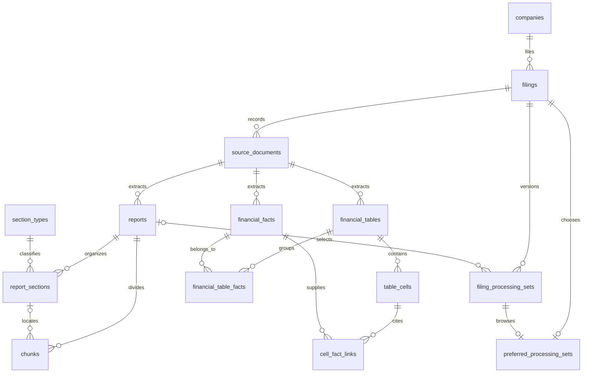

# Shared S&P 500 SEC Filing Database

This project provides a shared PostgreSQL database of S&P 500 companies' annual
and quarterly SEC reports. The automated pipeline downloads original filings
from EDGAR, extracts financial facts and statements, organizes report text into
sections and passages, and loads the results into AWS RDS. Approved teammates
can browse the same data in DBeaver or query it directly from Python.

> **Documentation assumption:** This guide describes the completed initial
> five-year backfill, as requested. It is not a live completion report. Use the
> [run-status commands](docs/automated-backfill.md) to check actual import progress
> and unresolved filings.

## Dataset scope

| Item | Coverage |
| --- | --- |
| Company universe | The S&P 500 membership snapshot dated October 13, 2026: 500 issuers and 503 share-class tickers |
| Filing window | October 13, 2021 through October 13, 2026, inclusive, based on filing date |
| Report types | Original **10-K** annual reports and **10-Q** quarterly reports; amendments are excluded |
| Financial data | XBRL facts with units, periods, dimensions, and original values; primary income, balance-sheet, and cash-flow statements |
| Report content | Cleaned report text, detected sections, and smaller text chunks with source references |
| Issuer history | Explicitly verified predecessor relationships, retaining the original filing company and CIK |
| Sources | Original documents and filing metadata from SEC EDGAR; index membership from a dated Wikipedia snapshot; current ticker mappings from the SEC |

The universe follows companies in the current snapshot, rather than every
company that belonged to the index at any point during the five-year period.
A new issuer may have fewer than five years of reports. Predecessor filings are
included only through a verified relationship; mergers and accounting-basis
changes still matter when comparing results. See the
[scope and predecessor-history guide](docs/automated-backfill.md).

## How the pipeline works

1. **Discover:** identify companies by SEC CIK and find their in-scope filings.
2. **Download:** archive the SEC source files and record their URLs, hashes, and retrieval dates.
3. **Extract and validate:** parse facts, statement cells, text, sections, and chunks; check source identity and correspondence.
4. **Load:** commit each accepted filing in one database transaction and save queue progress for resumption.

The importer runs as ordinary Python code; routine downloading, extraction,
validation, and loading do not require AI calls. Failed filings remain recorded
for investigation. Runs reuse unchanged imports for the selected version and
database. Scheduled refreshes require a separately configured scheduler; a
single batch invocation is not a recurring job.

Source documents remain in the ingest machine's archive. The database stores
their provenance and extracted content; connecting to RDS does not download the
original HTML/XML files to your computer.

## Database structure and report sections

Processing sets identify the exact fact, table, report, and chunk versions used
for a filing. **Select one processing set when analyzing a filing** so alternate
extractions and the retained manual example are not counted twice.

Preferred views (`section_catalog`, `statement_catalog`, `statement_cells`,
`fact_catalog`, and `chunk_catalog`) show only explicitly selected processing
sets. Importing a filing does not automatically make its set preferred. Browse
all versions through `filing_catalog`, `fact_provenance`, `chunk_citations`, and
`financial_tables`, or ask an administrator to
[select a validated processing set](docs/database-browsing.md#explicit-processing-sets).

In DBeaver, refresh **Schemas → sec** and its **Tables** and **Views** folders to see the new objects. Your existing connection and login still apply.

### Structure and browsing



This graph shows the main relationships. Every extracted object also belongs to a filing; composite foreign keys prevent links between different filings or report versions. A processing set selects exact source/version pairs for facts and tables, an exact report, and a chunking version. The migration ledger, `schema_migrations`, records schema updates.

| What you want | Where it resides | Convenient view |
| --- | --- | --- |
| Company name, CIK, display ticker, filing identity and dates | `companies`, `filings` | `filing_overview`, `filing_catalog` |
| Verified predecessor and co-registrant relationships | `issuer_successions`, processing-set metadata | `issuer_filing_history` |
| Original HTML/XML, source URL, hash, file locator | `source_documents`; source bytes remain in files/storage | Source columns in the catalogs |
| Full cleaned text | `reports.full_text` | Sections expose slices of this text |
| MD&A, risks, business, governance, other items | `report_sections` + `section_types` | `section_catalog` |
| Searchable passages and exact citations | `chunks`, linked to report and optionally section | `chunk_catalog` |
| Statement layout, row/column headings, displayed cells | `financial_tables`, `table_cells` | `statement_catalog`, `statement_cells` |
| Exact XBRL occurrences, units, periods, dimensions | `financial_facts`; `cell_fact_links` traces cells to occurrences | `fact_catalog` |
| Versions to use, coverage, validation checks | `filing_processing_sets`, `preferred_processing_sets` | `filing_overview` |

Start with **`filing_overview`**, then use the catalogs once that filing has an explicitly preferred processing set. A filing without a preferred set remains visible in the overview; its preferred catalogs are empty. Counts and validation apply to the selected scope, and a passed check does not mean the entire filing was extracted. The first query includes filings without preferred sets; the section queries include only selected sets.

```sql
SELECT company_name, ticker, cik, form, accession_number, set_key, coverage, validation_status
FROM sec.filing_overview ORDER BY filing_date DESC;

SELECT accession_number, original_title, part, item, text, source_url,
       section_validation_status, stage_coverage
FROM sec.section_catalog
WHERE section_type = 'mda';

SELECT accession_number, original_title, text, section_validation_status
FROM sec.section_catalog
WHERE section_topic IN ('risks', 'governance');
```

**MD&A maps to 10-Q Part I Item 2 or 10-K Part II Item 7.** Governance is usually in 10-K Part III; a filing may refer readers to a separate proxy statement, whose contents are not automatically loaded. See the [complete report map, selection workflow, migration notes, and limitations](docs/database-browsing.md) and [ready-to-run browsing queries](docs/database-browsing-queries.sql).

### Company tickers and data interpretation

`companies.cik` is the stable SEC issuer identifier. `companies.ticker` is a
current display symbol matched to that same CIK using SEC ticker data. For an
index member with multiple share classes, one SEC-confirmed index symbol is
selected for display; the local reference retains all listed symbols. Some
subsidiaries, operating partnerships, and predecessor issuers have no current
SEC ticker mapping and remain NULL. Do not substitute their parent's ticker.
See [ticker updates and selection rules](docs/company-tickers.md).

Keep each financial value's unit, period, dimensions, and source beside it.
Missing values are not zero. Untagged dashes and source discrepancies retain
their evidence and review status. Section names are detected labels unless
their validation status says otherwise. A completed backfill does not make all
figures comparable or every section label independently verified.

## Choose how to connect

**You can use DBeaver, connect directly from Python, or use both.** Have your database credentials ready, then follow the option that fits your work.

| What you want to do | Which option to use | What you need |
| --- | --- | --- |
| Browse tables, inspect a few records, run SQL manually, or export a CSV | [Option A: DBeaver](#option-a-connect-with-dbeaver) | DBeaver, your database login, and the AWS certificate |
| Pull data into a script or notebook for analysis or a repeatable workflow | [Option B: Direct Python connection](#option-b-connect-directly-from-python) | This repository, its Python environment, your database login, and the AWS certificate |
| Check the data visually, then automate the analysis | [Use both together](#use-dbeaver-and-python-together) | Complete the setup for each option once |

Both options connect from your computer to the **same PostgreSQL database on AWS**. DBeaver displays query results in a desktop app; Python loads them into variables and DataFrames. Python does not connect through DBeaver, and DBeaver does not need to be installed or running for Python to work. Saving a connection in DBeaver does not configure Python automatically.

You do not need an AWS account or a local PostgreSQL server to use the shared database. Both options use the same assigned login and `verify-full` SSL with the AWS certificate. A read-only account has the same permissions in either tool.

## Database credentials

Use the **database username and password already shared with you**. Keep them private. If you cannot find your credentials or your login fails, contact Michael.

## Option A: Connect with DBeaver

Choose this option to work with the database through menus, tables, and a SQL editor. You can complete this section without setting up Python or downloading this repository.

### A1. Install DBeaver and download the certificate

1. Download [DBeaver Community](https://dbeaver.io/download/), choose the version for your computer, and install it.
2. Download the [AWS security certificate](https://truststore.pki.rds.amazonaws.com/us-east-1/us-east-1-bundle.pem). This small file helps DBeaver check that it is connecting to the correct server.
3. Save it somewhere you can find again, such as a folder called **Database Access** in Documents. Keep the filename **`us-east-1-bundle.pem`**. Do not delete or move it after connecting.

If the certificate link opens a page of text instead of downloading a file, save that page with the filename above. It should end in `.pem`, not `.html` or `.txt`.

### A2. Enter the connection details

Open DBeaver and choose **Database → New Database Connection**. Select **PostgreSQL**, then click **Next**. PostgreSQL is simply the type of database we use.

Check whether DBeaver is asking for a **Host** or a **URL**. They use different formats. In Host mode, fill in Host, Port, and Database separately. In URL mode, use the full URL below instead.

| Box in DBeaver | What to enter |
| --- | --- |
| **Host** (Host mode only) | `sec-filings.cghyw6082mug.us-east-1.rds.amazonaws.com` — enter this only in the **Host** box. |
| **Port** | `5432` |
| **Database** | `sec_filings` |
| **URL** (URL mode only) | `jdbc:postgresql://sec-filings.cghyw6082mug.us-east-1.rds.amazonaws.com:5432/sec_filings` |
| **Username** | The database username the administrator gave you |
| **Password** | The matching database password |

Putting only the Host address into the **URL** box causes **Invalid JDBC URL**. The full URL includes the required `jdbc:postgresql://` beginning, port, and database name. Enter these values in DBeaver, not your web browser. The username and password are for this database, not for an AWS account.

### A3. Set up SSL and test the connection

In the same connection window:

1. Open the **SSL** tab. If you cannot see it, click **+** and select **SSL**.
2. If there is a **Use SSL** checkbox, turn it on.
3. Set **SSL Mode** to **`verify-full`**.
4. In **CA Certificate**, choose the `us-east-1-bundle.pem` file you saved in A1.
5. Leave **Client Certificate** and **Client Private Key** empty.
6. Click **Test Connection**. If DBeaver asks to download a PostgreSQL driver, allow it; this is the component it needs to talk to the database.
7. When the test succeeds, click **Finish**.

SSL protects the connection. The `verify-full` setting also checks the server's identity. Keep that setting enabled. If the options on your screen differ, ask the administrator to help with the [SSL settings](https://dbeaver.com/docs/dbeaver/SSL-Configuration/).

**Success at this step:** the connection test succeeds, and your new database connection appears in DBeaver's left-hand panel.

### A4. Open the filing list

You can now browse the data by clicking through the folders:

1. Expand your saved connection in the left-hand panel. It may be named **postgres**, or another name you chose. Open **Databases → sec_filings** if the Databases folder is shown.
2. Open **Schemas → sec → Views**. Think of `sec` as the folder containing this project's information.
3. Double-click **filing_catalog**.
4. Select the **Data** tab to display its rows.

`filing_catalog` is a prepared summary of the reports in the database. You do not need to write a query to view it. See [DBeaver's Data tab help](https://dbeaver.com/docs/dbeaver/Data-Editor/) if needed.

These column names may be unfamiliar:

| Column | What it means |
| --- | --- |
| `company_name` | The company that submitted the report |
| `ticker` | A current SEC-matched display symbol, when one is available |
| `cik` | The company's stable SEC identifier |
| `form` | `10-Q` means a quarterly report; `10-K` means an annual report |
| `filing_date` | The date the report was filed |
| `accession_number` | The report's unique reference number |
| `source_document_count` | How many original source files are recorded for that report |

**What you should see in the completed dataset:** annual and quarterly filings
across the company universe and filing window above. Filter by CIK or ticker,
then sort by filing date. The catalog counts include all stored extraction
versions; use a processing set for analysis of a single version.

The original `manual-example-v1` Microsoft example remains available as a small
learning exercise. Its [guide and fixed sample queries](docs/manual-example.md)
are separate from the full dataset. A local development database contains only
what you have loaded into it; creating it does not copy the shared AWS data.

The next time you want to use the database, open DBeaver, connect to the saved connection, and open **filing_catalog → Data** again.

### A5. Explore the individual tables

The filing list is a summary. To see the information behind it:

1. In the left-hand panel, open **your connection → Databases → sec_filings → Schemas → sec → Tables**. If your connection does not show a Databases folder, go directly to **Schemas → sec → Tables**.
2. Double-click a table name, such as **companies**.
3. Click its **Data** tab to see the rows.

Clicking the small arrow beside a table expands details such as its columns. To view the actual records, double-click the table's name and choose **Data**.

| Table | What you will find there |
| --- | --- |
| **companies** | Company names, stable SEC CIKs, and current display tickers where available |
| **filings** | The reports each company filed, including dates and reference numbers |
| **source_documents** | Details and source links for the original files belonging to each report |
| **reports** | Processed text extracted from the original documents |
| **chunks** | Smaller sections of that text, used to find and cite specific passages |
| **financial_facts** | Individual financial figures, such as revenue, with their dates, units, and sources |
| **financial_tables** | Extracted financial statement tables |
| **financial_table_facts** | Links showing which financial figures belong to which statement tables |
| **report_sections**, **section_types** | Named report sections, topic labels, source locations, and validation status |
| **filing_processing_sets**, **preferred_processing_sets** | Exact extraction versions, coverage and checks; optional preferred choices for browsing |
| **table_cells**, **cell_fact_links** | Statement cells and their links to source XBRL facts |
| **cell_source_observations** | Evidence for source-only statement markers that are not invented financial facts |
| **issuer_successions** | Verified links between current and predecessor issuers |
| **schema_migrations** | The database's technical update history; you can skip this when browsing the data |

One company can have many filings, and each filing can have several source
documents. Related tables hold its text, sections, statements, facts, and
citations. `companies` also includes related registrants and predecessors, so
its row count need not equal the number of companies in the index snapshot.

Columns ending in **`_id`** connect related records. For example, a filing's **company_id** matches the **id** of its company, and a source document's **filing_id** matches the **id** of its filing. These long identifiers let the database keep the relationships clear.

#### Trace a company report to its sources

1. Open **companies → Data** and find a company, for example Microsoft (`MSFT`, CIK `0000789019`).
2. Open **filing_catalog → Data** and filter by that CIK. Choose a 10-K or 10-Q and note its accession number and filing ID.
3. Find that filing's rows in **filing_processing_sets** and note the selected source IDs and extraction versions.
4. Open **source_documents → Data** and filter by the filing ID. **source_url** points to each original SEC document.
5. Use **fact_provenance** for values and sources, **chunk_citations** for text and citations, or **financial_tables.readable_text** for statements. Apply the filing and processing-version filters from step 3.

For a smaller exercise with fixed expected results, use the
[six manual-example queries](docs/manual-example-queries.sql). They explicitly
select `manual-example-v1` and do not measure full-dataset coverage.

When reading a financial figure, keep its **unit and period** beside it. For example, a value stored in dollars differs from a statement displayed in millions, and a three-month amount differs from a nine-month amount even when they end on the same date. The [example guide](docs/manual-example.md#read-the-values-correctly) explains both cases. If you see **Permission denied**, ask the administrator for access to the specific table or view.

### A6. Understand the tabs and refresh the data

When you open a table, DBeaver provides different ways to look at it:

| Tab or button | What it does |
| --- | --- |
| **Data** | Shows the actual records in rows and columns. Use this for everyday browsing. |
| **Properties** | Describes the table: its column names, data types, and other settings. |
| **Diagram** | Shows how the table relates to other tables. |
| **Refresh / F5** | Reloads the information, for example after another team has added records. |

If you opened **chunks** and only see a list of column names such as `id`, `filing_id`, and `text`, you are looking at **Properties**. Select **Data** to switch to the records themselves.

### A7. Run a SQL query and export results

1. Select your saved shared-database connection in the left-hand panel.
2. Choose **SQL Editor → New SQL Editor** from the top menu. Some versions label this **New SQL Script**. Check that the editor is using your shared connection and database `sec_filings`. See [DBeaver's SQL editor guide](https://dbeaver.com/docs/dbeaver/SQL-Editor/).
3. Paste the statements below. Highlight the first statement, including its semicolon, and choose **SQL Editor → Execute SQL Statement**. Repeat for the second statement. On Windows, **Ctrl+Enter** runs the selected statement. See [SQL execution](https://dbeaver.com/docs/dbeaver/SQL-Execution/).

```sql
SELECT current_database() AS database_name, current_user AS username;

SELECT company_name, ticker, cik, form, filing_date, accession_number,
       reporting_period_end, source_document_count
FROM sec.filing_catalog
WHERE cik = '0000789019'
ORDER BY filing_date DESC, accession_number DESC
LIMIT 20;
```

**Expected result:** the first query shows `sec_filings` and your assigned
username. The second lists up to 20 Microsoft filings, newest first. Substitute
another company's CIK to browse its reports. Both statements only read data.

To save query results as a CSV:

1. Right-click inside the result grid and choose **Export Data**.
2. Select **CSV**, then **Next**. Review the columns and extraction options. Choose **Query the database** to export the complete query result; **Use fetched rows** includes only rows already loaded in the grid. Leave **Selected rows only** off unless you want a subset.
3. Continue through the format options, choose a local folder and a new filename, then click **Finish** on the final page. See [DBeaver's export guide](https://dbeaver.com/docs/dbeaver/Data-export/).

A CSV is a snapshot saved on your computer. Editing it does not update the database, and new database records do not appear in an existing CSV. Rerun the query and export again when you need a fresh copy.

## Option B: Connect directly from Python

Choose this option to query the database inside your Python workflow. Have your [database credentials](#database-credentials) ready, then start at B1; you can skip Option A entirely. The project's `connect()` helper uses `psycopg` to connect directly to PostgreSQL and reads your connection settings from `.env.aws`.

The examples below read data for analysis. Saving processed results back to the shared database requires separate write access from Michael.

### B1. Set up Python

Get a local copy of this repository and install [uv](https://docs.astral.sh/uv/getting-started/installation/). Open a terminal in the repository root: the folder containing `readme.md` and `pyproject.toml`. Run:

```powershell
uv sync --locked
```

This prepares the project's `.venv` environment using the pinned Python 3.12.14 and locked packages, including `psycopg` for PostgreSQL and `pandas` for working with tables. [uv runs project commands in this environment](https://docs.astral.sh/uv/guides/projects/), so you do not need to activate it manually when using `uv run` below.

### B2. Save your connection settings

On Windows, run these commands in PowerShell to save the AWS certificate inside the repository. If the file is already there, keep it.

```powershell
New-Item -ItemType Directory -Force .cache\aws-rds | Out-Null
if (-not (Test-Path .cache\aws-rds\us-east-1-bundle.pem)) {
    Invoke-WebRequest -Uri 'https://truststore.pki.rds.amazonaws.com/us-east-1/us-east-1-bundle.pem' -OutFile .cache\aws-rds\us-east-1-bundle.pem
}
```

Create **`.env.aws`** in the repository root with the content below. Replace the username and password placeholders with your own credentials. If you already have a working `.env.aws`, keep its settings.

```dotenv
PGHOST=sec-filings.cghyw6082mug.us-east-1.rds.amazonaws.com
PGPORT=5432
PGDATABASE=sec_filings
PGUSER=YOUR_DATABASE_USERNAME
PGPASSWORD=CHANGE_ME
PGSSLMODE=verify-full
PGSSLROOTCERT=.cache/aws-rds/us-east-1-bundle.pem
```

If you already downloaded the certificate for DBeaver, you can reuse it: set `PGSSLROOTCERT` to its full path, such as `C:/Users/YourName/Documents/Database Access/us-east-1-bundle.pem`. Keep `verify-full` enabled. Values in this file are literal; do not add shell variables or inline comments. `.env.aws` and `.cache/` are ignored by Git. Keep passwords out of Python files, notebooks, and screenshots.

Use the same host, port, database, and personal login as DBeaver if you use both tools. The DBeaver `jdbc:postgresql://...` URL is not a Python connection setting; use the separate `PG*` fields shown above.

### B3. Run your first query

Save the following as **`database_workflow.py`** in the repository root. It finds
Microsoft's latest quarterly filing with a passed processing set and loads that
set's financial facts into a pandas DataFrame. It uses the preferred set when
available, otherwise the most recently stored passed set, and prints the choice
so you can inspect its version and coverage.

```python
import pandas as pd
from psycopg.rows import dict_row
from sec_pipeline.database import connect

cik = "0000789019"  # Change this to another company's SEC CIK.
form = "10-Q"       # Use "10-K" for an annual report.

with connect(".env.aws", row_factory=dict_row) as conn:
    conn.execute("SET TRANSACTION READ ONLY")
    print(conn.execute(
        "SELECT current_database() AS database_name, current_user AS username"
    ).fetchone())

    filing = conn.execute("""
        SELECT f.id AS filing_id, c.name AS company_name, c.cik, c.ticker,
               f.form, f.filing_date, f.accession_number, f.reporting_period_end,
               p.set_key, p.coverage, p.fact_source_document_id,
               p.fact_extraction_version
        FROM sec.filings AS f
        JOIN sec.companies AS c ON c.id = f.company_id
        JOIN sec.filing_processing_sets AS p ON p.filing_id = f.id
        LEFT JOIN sec.preferred_processing_sets AS preferred
            ON preferred.filing_id = f.id
        WHERE c.cik = %s AND f.form = %s AND p.validation_status = 'passed'
          AND p.fact_source_document_id IS NOT NULL
        ORDER BY f.filing_date DESC,
                 (p.id = preferred.processing_set_id) DESC NULLS LAST,
                 p.created_at DESC, f.accession_number DESC, p.set_key
        LIMIT 1
    """, (cik, form)).fetchone()
    if filing is None:
        raise RuntimeError("No matching filing with a passed fact selection was found.")
    print(filing)

    cursor = conn.execute("""
        SELECT fact_id, concept_namespace, concept_name, label, numeric_value,
               unit, period_kind, period_start, period_end, instant_date,
               dimensions, occurrence_key, accession_number, extraction_version,
               source_url, sha256
        FROM sec.fact_provenance
        WHERE filing_id = %s AND source_document_id = %s AND extraction_version = %s
        ORDER BY concept_name, period_start, period_end, instant_date, occurrence_key
    """, (filing["filing_id"], filing["fact_source_document_id"],
          filing["fact_extraction_version"]))
    facts = pd.DataFrame.from_records(
        cursor.fetchall(), columns=[column.name for column in cursor.description]
    )

print(f"Loaded {len(facts)} financial facts")
print(facts[["concept_name", "numeric_value", "period_start", "period_end"]].head())
```

Run it from the repository root:

```powershell
uv run --locked python database_workflow.py
```

**Expected result:** the script prints your connection identity, the selected
filing and processing set, and its financial-fact count. The count depends on
that filing and version; there is no fixed 24-row sample limit. The connection
closes when the `with` block ends, while `facts` remains available for analysis.
`SET TRANSACTION READ ONLY` prevents this example from changing database records.

The [`dict_row` option](https://www.psycopg.org/psycopg3/docs/api/rows.html#psycopg.rows.dict_row) gives each result column a name. The `%s` markers pass values separately from SQL; keep using [query parameters](https://www.psycopg.org/psycopg3/docs/basic/params.html) when changing the company or report type. Do not build queries with f-strings or string concatenation. For a reproducible analysis, record the printed accession and processing-set key and select that exact set on subsequent runs.

### B4. Use the results in your workflow

Add analysis below the query in the same script. For example, inspect USD
duration facts ending on the selected report's period-end date:

```python
def is_usd(unit):
    return (
        isinstance(unit, dict)
        and unit.get("numerator") == ["{http://www.xbrl.org/2003/iso4217}USD"]
        and unit.get("denominator") == []
    )


period_usd = facts.loc[
    facts["unit"].apply(is_usd)
    & facts["period_kind"].eq("duration")
    & facts["period_end"].eq(filing["reporting_period_end"])
]
print(period_usd[["concept_name", "numeric_value", "period_start", "period_end", "dimensions"]])
```

Financial values arrive as Python `Decimal` values to preserve precision. The
same end date can have quarterly, year-to-date, and annual durations; check
`period_start` before comparing or combining values. Keep units, dimensions, and
sources beside each amount. Different concepts or dimensions should not be added
together automatically. Missing values are not zero. See
[how to read financial values](docs/manual-example.md#read-the-values-correctly).

For a local CSV, append this to the same script:

```python
from pathlib import Path

Path("data/processed").mkdir(parents=True, exist_ok=True)
filename = f"{filing['cik']}-{filing['accession_number']}-{filing['fact_extraction_version']}.csv"
facts.to_csv(Path("data/processed") / filename, index=False, mode="x")
```

The export folder is ignored by Git. `mode="x"` prevents overwriting an existing file; choose a new filename for another export. The CSV is a local copy and does not update PostgreSQL. It stores structured fields such as units and dimensions as text; use the DataFrame for calculations that need those fields.

In VS Code, select this repository's `.venv\Scripts\python.exe` interpreter on Windows. In a notebook, use a kernel backed by the same environment. Keep the working directory at the repository root so the settings and certificate paths resolve correctly.

For other tasks, query `sec.chunk_citations` for text and citations or
`sec.financial_tables` for statements, filtering to the selected report or
table-source ID and version. The [database browsing queries](docs/database-browsing-queries.sql)
show the relevant joins. For writing extracted results, use the
[loader contracts and transactions](docs/database.md#python-transactions) with
an approved write-capable account.

### B5. Troubleshoot Python connections

| What you see | What to do |
| --- | --- |
| **`uv` is not recognized** | Install uv using the link above, then open a new terminal. |
| **`ModuleNotFoundError`** | Run `uv sync --locked` in the repository root, then use `uv run --locked python database_workflow.py`. Check the interpreter or notebook kernel if running from an editor. |
| **Set a non-placeholder password** | Replace `CHANGE_ME` in `.env.aws` and check that the file is in your working directory. |
| Python connects to the wrong database | Use `connect(".env.aws")`; plain `connect()` uses the local `.env`. Existing process `PG*` environment variables override matching file settings. `DATABASE_URL` is not read by this helper. |
| **Certificate error**, **timeout**, or **authentication failed** | Check the certificate path, host, port, and assigned credentials. The connection troubleshooting below also applies to Python. |
| No matching filing is found, or **0 facts** are returned | Check the CIK, report type, connection target, and available processing sets. A local database contains only the data loaded into that instance. |
| **Permission denied** when writing | Personal reader accounts allow queries. Ask Michael for the appropriate loader access before writing shared results. |

## Use DBeaver and Python together

1. Use DBeaver to inspect the tables and test a small `SELECT` query. Note the filing, extraction version, units, and periods you selected.
2. Set up Python separately using Option B and the same database credentials. You can point both tools to the same certificate file.
3. Put the query inside `conn.execute(...)` in your script. Replace values that change, such as accession numbers, with `%s` placeholders and pass their values separately, as shown in B3. In DBeaver, use actual quoted values as shown in A7; `%s` placeholders belong to the Python driver.
4. Compare the results using the same filters. Once they match, run the Python script whenever you need updated data; DBeaver can be closed.

For occasional manual work, a DBeaver CSV export may be enough. For a repeatable workflow, query from Python so each run reads the database directly. In either case, local DataFrames and exported files keep their existing contents until you query or export again. Changing a DataFrame does not write changes back to PostgreSQL.

## Connection troubleshooting

| What you see | What to do |
| --- | --- |
| **Invalid JDBC URL** | In DBeaver, **Host** takes the server address alone; **URL** takes the full `jdbc:postgresql://...:5432/sec_filings` value from A2. Python uses the `PG*` settings from B2. |
| The connection keeps waiting or says **timed out** | Check the host and port from A2 or B2. Your Wi-Fi, VPN, or local firewall may block database connections. Send Michael the error and network context so he can check the connection and RDS status; individual IPv4 approval is not required. |
| **Password authentication failed** | Check that you used the database username and password provided to you. Ask the administrator to check your login if it still fails. |
| A **certificate** or **SSL** error | Check the certificate's saved location: DBeaver selects it in the SSL tab; Python uses `PGSSLROOTCERT`. Use the host address exactly as shown above and keep `verify-full` enabled. |
| **Permission denied** | You connected, but your login is not allowed to open that item. Send its name to the administrator. |
| You cannot find **sec** or **filing_catalog** | Check that you opened `sec_filings`, then **Schemas → sec → Views**. Ask the administrator if it is missing. |
| The new tables or views are missing in DBeaver | Refresh **Schemas → sec**, then its **Tables** and **Views** folders. Ask the administrator to check this database's migration ledger; local and shared databases are separate instances. |
| Preferred catalogs contain no rows | Check `filing_overview.set_key`. NULL means no preferred processing set is selected. Browse all versions through `fact_provenance`, `chunk_citations`, and `financial_tables`, using explicit filing/source/version filters. |
| A company's ticker is NULL | Its profile may need a ticker refresh, or the issuer may have no current SEC mapping. Check the CIK and the [ticker guide](docs/company-tickers.md); do not infer a parent or successor ticker. |
| Other views contain no rows | Press **F5**, clear old filters, and confirm the shared RDS connection. Check the requested filing and processing set. A local database is not automatically synchronized with AWS. |

When asking for help, include the error message and which step you reached. Keep your password out of messages and screenshots.

## For developers and administrators

On the ingest machine, use the saved queue to check the initial backfill:

```powershell
uv run --locked python scripts/backfill_sec.py --status --universe data/backfill/2026-10-13/universe.json --state data/backfill/2026-10-13/queue.json --since 2021-10-13 --until 2026-10-13
```

Queue and source files are local operational artifacts, not data automatically
provided to every reader by cloning this repository. Live database counts and
processing-set coverage should be checked separately. Completion means every
in-scope accession is accounted for at the intended destination and processing
version; a successful small batch or one passing parser check does not establish
that condition. Review-required records retain their explicit quality flags.

These guides cover ingestion, maintenance, and the data contracts:

- [Automated discovery, import, resumption, and current run status](docs/automated-backfill.md)
- [Company ticker refresh and existing-record updates](docs/company-tickers.md)
- [Report sections, processing sets, and database browsing](docs/database-browsing.md)
- [SQL browsing examples](docs/database-browsing-queries.sql)
- [GitHub tutorial: personal branches, commits, and pull requests to main](docs/github-tutorial.md)
- [Python access, SQL examples, and project commands](docs/developer-usage.md)
- [Optional manual example: six queries and fixed expected results](docs/manual-example.md)
- [Database structure and local setup](docs/database.md)
- [AWS deployment and maintenance](docs/aws-deployment.md)
- [Team implementation plan](docs/team-implementation-plan.md)

This is a QMSS practicum project using public SEC filings. Source provenance,
version selection, and validation evidence remain attached to the extracted
data so downstream analysis can trace a value or passage to its original report.
